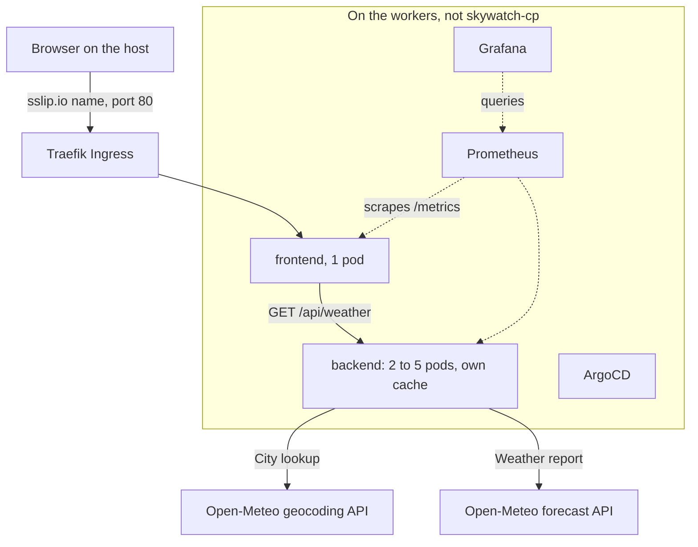
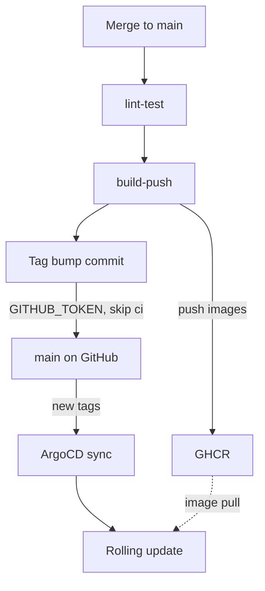
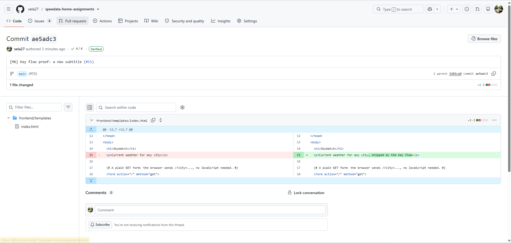
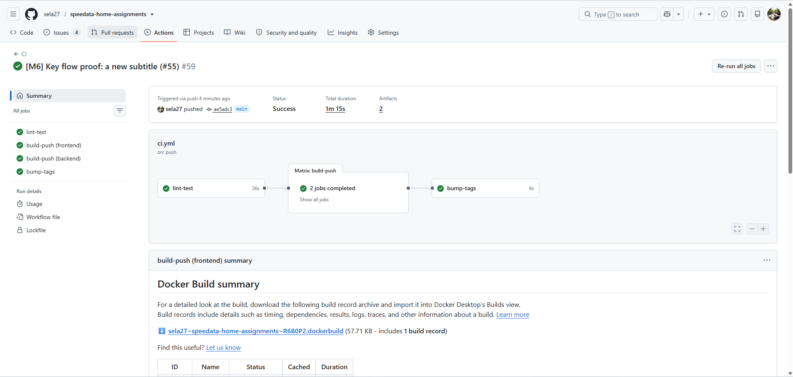
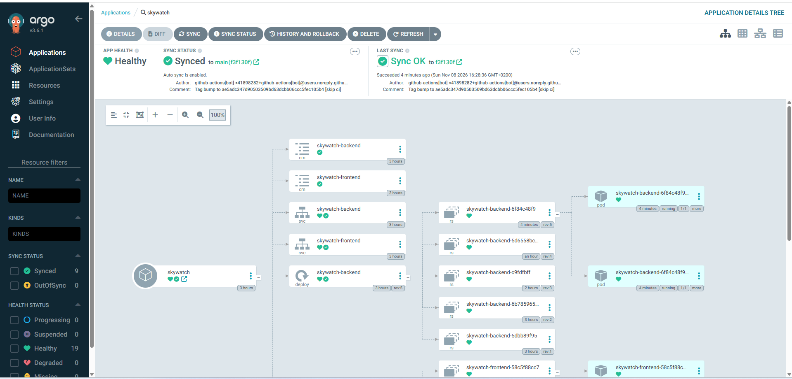
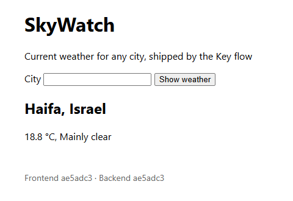

# SkyWatch

A small weather-query app (a Flask frontend and a backend API that calls Open-Meteo) running on a local multi-node K3s cluster, delivered through CI (GitHub Actions → GHCR) and GitOps (ArgoCD).

> **Status: work in progress.** Two pieces of milestone M6 are still to come: the video of the Key flow ([#34](https://github.com/sela27/speedata-home-assignments/issues/34)) and a final pass over the README ([#35](https://github.com/sela27/speedata-home-assignments/issues/35)).

## Chosen path

**Path A**: three Ubuntu 24.04 VMs created with Multipass (one control plane, two workers), with K3s installed by Ansible.

## Supported host

Windows 11 Pro with Hyper-V. Other host operating systems are not supported.

The VMs take 6 vCPU, 12 GiB RAM and up to 55 GiB of disk from the host:

| VM | Node network address | vCPU | RAM | Disk |
| --- | --- | --- | --- | --- |
| `skywatch-cp` (control plane) | 192.168.60.10 | 2 | 4 GiB | 15 GiB |
| `skywatch-worker1` | 192.168.60.11 | 2 | 4 GiB | 20 GiB |
| `skywatch-worker2` | 192.168.60.12 | 2 | 4 GiB | 20 GiB |

The disks grow as they fill: after two days of running, the three VMs had 15 GiB in use together. Docker Desktop's own VM comes on top of this. Tested on a host with 20 logical processors and 32 GiB RAM.

Bring-up writes everything it generates (the SSH key pair, the host kubeconfig, rendered cloud-init files) under `.state/`, which Git ignores.

## Prerequisites

Tested with these versions. Each check runs in a normal Windows PowerShell window.

| Tool | Tested with | Check | What it is for |
| --- | --- | --- | --- |
| Windows 11 Pro, with Hyper-V on | 25H2 (build 26200) | `Get-Service vmms` is `Running`, and `Get-Module -ListAvailable Hyper-V` lists the module | the VMs, and the switch for the Node network |
| Windows PowerShell | 5.1.26100 | `$PSVersionTable.PSVersion` | runs the scripts. They were tested in 5.1 only, not in PowerShell 7. |
| [Multipass](https://canonical.com/multipass/install) | 1.17.0, `hcs` driver | `multipass version`, and `multipass get local.driver` prints `hcs` | creates the three VMs |
| [Docker Desktop](https://docs.docker.com/desktop/setup/install/windows-install/) | 4.80.0 (Engine 29.6.1), WSL 2 backend | `docker version` prints a `Server` section | runs the Ansible container (`2-cluster`) and k6 (`load`) |
| [kubectl](https://kubernetes.io/docs/tasks/tools/install-kubectl-windows/) | v1.36.0 | `kubectl version --client` | the passwords and the checks. Use 1.36 to 1.38, within one minor version of K3s v1.37. |
| [Git](https://git-scm.com/downloads/win) | 2.53.0 | `git --version` | the clone |
| OpenSSH client | 9.5p2, built into Windows 11 | `Get-Command ssh-keygen` finds it, and `ssh -V` prints the version | `1-vms` generates the SSH key that Ansible logs in with |
| [Helm](https://helm.sh/docs/intro/install/) (optional) | v4.1.4 | `helm version` | not used by any Bring-up step: `2-cluster` uses the Helm v4.3.1 inside the Ansible container. Only for running CI's chart checks locally, such as `helm lint --strict charts/skywatch`. |

`curl.exe`, used in the checks below, ships with Windows 11.

### On a fresh Windows 11 Pro machine

Do these once, before the first script:

1. **Hardware virtualization on** in the BIOS/UEFI settings. Hyper-V and Docker Desktop both need it.
2. **Hyper-V on.** In an elevated PowerShell (Start, type `Windows PowerShell`, right-click, **Run as administrator**), run Microsoft's command, then answer `Y` to restart ([Install Hyper-V](https://learn.microsoft.com/en-us/windows-server/virtualization/hyper-v/get-started/install-hyper-v)):

   ```powershell
   Enable-WindowsOptionalFeature -Online -FeatureName Microsoft-Hyper-V -All
   ```

   `0-network` also needs Hyper-V's PowerShell module, which comes with Hyper-V's management tools: without it, the script's `#Requires -Modules Hyper-V` line stops it. After the restart, if `Get-Module -ListAvailable Hyper-V` lists nothing, add the module in an elevated window, then check again in a new window:

   ```powershell
   Enable-WindowsOptionalFeature -Online -FeatureName Microsoft-Hyper-V-Management-PowerShell -All
   ```

   Or, in **Turn Windows features on or off**, under **Hyper-V** and **Hyper-V Management Tools**, select **Hyper-V Module for Windows PowerShell**.
3. **Install the tools** in the table. The Multipass installer asks for administrator rights. Then open a new PowerShell window, so that `PATH` has them.
4. **Docker Desktop running.** It doesn't start by itself after the install: start it from the Start menu and accept its terms. `docker version` must print a `Server` section.
5. **Scripts allowed.** On Windows clients, the default execution policy is `Restricted`, which runs no scripts at all ([about_Execution_Policies](https://learn.microsoft.com/en-us/powershell/module/microsoft.powershell.core/about/about_execution_policies?view=powershell-5.1)). Allow local scripts for your user, once. This needs no elevation:

   ```powershell
   Set-ExecutionPolicy -Scope CurrentUser -ExecutionPolicy RemoteSigned
   ```

   To change nothing that lasts, run `Set-ExecutionPolicy -Scope Process -ExecutionPolicy RemoteSigned` in each new window instead. A `CurrentUser` policy belongs to that user only: if your elevated window runs as another account, run the `-Scope Process` line there too. `RemoteSigned` runs the scripts of a `git clone`. It blocks the scripts of a ZIP downloaded in a browser, which marks them as from the internet: unblock those with `Get-ChildItem -Recurse | Unblock-File`.
6. **One elevated window.** `0-network` needs **Run as administrator**, because it creates a Hyper-V switch. Everything else runs in a normal window.

## Bring-up

Run each step from the repository root in Windows PowerShell. Every script is safe to re-run: if one fails, fix what its error names, then run the same step again.

### Clone the repository

```powershell
git clone https://github.com/sela27/speedata-home-assignments.git
cd speedata-home-assignments
```

ArgoCD deploys what is on `main` on GitHub, not what is in your clone. A local edit changes nothing in the cluster until it reaches `main` (the Key flow).

- **Expected:** a `speedata-home-assignments` folder. The commands below run in it.
- **Takes:** seconds.
- **Re-run:** not needed. `git pull` updates the clone.

### 0. The Node network: `0-network` (elevated)

Open a PowerShell window with **Run as administrator**. It starts in `C:\Windows\System32`, so `cd` to your clone first: `Get-Location` in your normal window shows its path. For a clone made where a new normal window starts, your home folder:

```powershell
cd "$HOME\speedata-home-assignments"
.\scripts\0-network.ps1
```

It creates the internal Hyper-V switch `skywatch` and gives the host 192.168.60.1/24 on it: the Node network ([ADR-0001](docs/adr/0001-dedicated-hyperv-switch-static-node-ips.md)). It marks the switch as its own in the switch's Notes, and touches no other switch.

- **Expected:**

  ```text
  Created the Node network switch 'skywatch'.
  Assigned 192.168.60.1/24 to 'vEthernet (skywatch)'.
  ```

  In a window that is not elevated, the script stops at once and changes nothing: `The script '0-network.ps1' cannot be run because it contains a "#requires" statement for running as Administrator.`
- **Takes:** seconds.
- **Re-run:** safe. It prints `Node network switch 'skywatch' already exists; leaving it unchanged.` and `'vEthernet (skywatch)' already has 192.168.60.1/24.` If a switch named `skywatch` exists that it didn't create, it stops and changes nothing.

You can close the elevated window now.

### 1. The VMs: `1-vms`

In a normal PowerShell window:

```powershell
.\scripts\1-vms.ps1
```

It generates the SSH key pair `.state\id_ed25519`, then launches the three VMs with Multipass, one after the other. Each VM has two NICs. Its default NIC, on Multipass's own network, is its Uplink to the internet. The second NIC, on the `skywatch` switch, gets the VM's fixed Node network address through cloud-init. cloud-init also installs the public key, so Ansible can log in.

- **Expected:** `Generated the SSH key pair ...\.state\id_ed25519.`, Multipass's progress for each VM (`Launched: skywatch-cp in zone1`), and one line per VM:

  ```text
  skywatch-cp at 192.168.60.10: created.
  skywatch-worker1 at 192.168.60.11: created.
  skywatch-worker2 at 192.168.60.12: created.
  ```

  `multipass list` then shows the three VMs `Running`, each with its 192.168.60.x address.
- **Takes:** about 3 minutes, about a minute per VM, once Multipass has the Ubuntu 24.04 image. The first launch on a machine downloads the image first.
- **Re-run:** safe. A running VM is left unchanged (`skywatch-cp at 192.168.60.10: already running; left unchanged.`). A stopped VM, for example after a host reboot, is started. A re-run never resizes a VM. The script stops if `.state\id_ed25519` is missing while the VMs exist, because they accept only that key: restore the key, or run `down` first.

### 2. The cluster and ArgoCD: `2-cluster`

```powershell
.\scripts\2-cluster.ps1
```

It builds the Ansible container image from `ansible/` and runs the playbook `ansible/site.yml` in it, over the Node network:

1. K3s v1.37.2+k3s1 on the control plane, which is tainted `NoSchedule`, so app pods run only on the workers.
2. The two workers join, with a token read from the control plane at run time and never stored on the host or in Git.
3. `.state\kubeconfig` for kubectl on this host.
4. ArgoCD (chart 10.14.0, ArgoCD v3.6.1), the Grafana admin Secret with a random password, and the root Application.

From then on ArgoCD deploys everything else from `apps/` on `main`: the `skywatch` app and the `monitoring` app (Prometheus and Grafana).

- **Expected:** `Building the Ansible container image 'skywatch-ansible'...`, then each Ansible task, then a `PLAY RECAP` with `unreachable=0 failed=0` for `localhost`, `skywatch-cp`, `skywatch-worker1` and `skywatch-worker2`. On the ArgoCD task, a `[DEPRECATION WARNING]` and a `[WARNING]` about it are normal: the Helm module flags its own deprecated return value. A re-run adds a second `[WARNING]`, because the helm diff plugin isn't installed. It ends with the URLs and the password commands (see [URLs and passwords](#urls-and-passwords)):

  ```text
  K3s and ArgoCD are up. ArgoCD deploys the apps in apps/ from Git, on main. From this host:
    the cluster:  kubectl --kubeconfig .state\kubeconfig get nodes
    SkyWatch:     http://skywatch.192-168-60-11.sslip.io  (once ArgoCD has synced it)
    ...
  ```

- **Takes:** about 2.5 minutes. The first run on a machine also builds the Ansible image. After that, ArgoCD needs about 1.5 more minutes until its three apps are `Synced` and `Healthy`. On the way they show `OutOfSync`, `Progressing` or `Degraded` while images pull: that is normal.
- **Re-run:** safe, and takes seconds. On a healthy cluster it reports `changed=0` on all four hosts (see the [checklist](#verification-checklist)). It installs K3s only where it is missing or at another version, and restarts K3s only when its config changed. It never rotates the Grafana password. It puts the root Application back if it was edited by hand. A first run that stopped halfway, for example on an image-pull timeout, completes when run again.

### Load for the dashboard and the HPA: `load` (optional)

```powershell
.\scripts\load.ps1
```

It runs the k6 load generator ([scripts/load.js](scripts/load.js)) in a pinned `grafana/k6:2.3.0` container. For 5 minutes k6 asks the frontend's Ingress for pages, 10 cities in turn, at up to 45 pages a second. It calls nothing else: Open-Meteo sees only the backend's cache misses, far under its free limit of 10,000 calls a day.

- **Expected:** k6's progress, then its summary. The backend HPA scales from 2 replicas to 3 about 2 minutes in, and back to 2 about 5 minutes after the load ends: `kubectl --kubeconfig .state\kubeconfig -n skywatch get hpa` shows the `REPLICAS`. A few pages may fail while the backend's caches are cold, when their Open-Meteo call passes the backend's 5 s timeout. Ctrl+C stops k6 early: it prints its summary, exits with code 105, and the script reports that exit code as a failure.
- **Takes:** 5 minutes.
- **Re-run:** safe once the previous run has ended. While one runs, a second can't start: its container name is taken.

### Tear-down: `down`

```powershell
.\scripts\down.ps1
```

It deletes and purges the three VMs, and no other Multipass instance. The switch stays, and so does `.state\`: the next `1-vms` reuses the SSH key, and the next `2-cluster` rewrites the kubeconfig.

- **Expected:**

  ```text
  Deleted skywatch-cp.
  Deleted skywatch-worker1.
  Deleted skywatch-worker2.
  Left the Node network switch 'skywatch' in place. To remove it too, run down.ps1 -RemoveSwitch elevated.
  ```

  `multipass list` then prints `No instances found.`, unless you have other instances.
- **Takes:** seconds.
- **Re-run:** safe. It prints `skywatch-cp does not exist; nothing to delete.` for each VM.

To remove the switch and the host's 192.168.60.1 too, run it in an elevated window, in your clone (`cd` there first, as for `0-network`):

```powershell
.\scripts\down.ps1 -RemoveSwitch
```

It removes only a switch that `0-network` created, and prints:

```text
Deleted skywatch-cp.
Deleted skywatch-worker1.
Deleted skywatch-worker2.
Removed the Node network switch 'skywatch' and the host's address on it.
```

In a window that is not elevated, it stops before deleting anything: `-RemoveSwitch needs an elevated PowerShell (Run as Administrator). Nothing was changed.`

### If a step fails

- `1-vms` can stop with `launch failed: ... timed out waiting for initialization to complete`. When that happened, Multipass had given up, not the VM: cloud-init's `netplan apply` renewed the VM's Uplink address during the launch, and Multipass kept waiting for SSH at the old one. A re-run then stops at that VM with `exists but is not on the Node network`. Remove only that VM, then run `1-vms` again. It leaves the other VMs unchanged and creates this one in about a minute:

  ```powershell
  multipass delete --purge skywatch-worker2   # the VM named in the error
  .\scripts\1-vms.ps1
  ```

- After the host moves to another network, ArgoCD can show `lookup github.com ... server misbehaving`: CoreDNS still forwards to the old network's DNS servers. Restart it with `kubectl --kubeconfig .state\kubeconfig -n kube-system rollout restart deployment/coredns`.
- After a host reboot, `multipass list` may show a VM `Stopped`. Run `.\scripts\1-vms.ps1`: it starts it. The addresses are fixed, so the kubeconfig and the URLs keep working.

## Using the cluster

### The kubeconfig

`2-cluster` writes `.state\kubeconfig`. It points at the API server on the control plane's Node network address, `https://192.168.60.10:6443`, and holds the cluster's admin credentials. Git ignores it. Run kubectl from the repository root:

```powershell
kubectl --kubeconfig .state\kubeconfig get nodes
```

Or set it once per window, after which plain `kubectl` works. [docs/alerts.md](docs/alerts.md) assumes this:

```powershell
$env:KUBECONFIG = "$PWD\.state\kubeconfig"
kubectl get nodes
```

### URLs and passwords

| What | URL | Login |
| --- | --- | --- |
| SkyWatch | <http://skywatch.192-168-60-11.sslip.io> | none |
| ArgoCD | <http://argocd.192-168-60-11.sslip.io> | `admin`, and the password below |
| Grafana | <http://grafana.192-168-60-11.sslip.io> | `admin`, and the password below. The SkyWatch dashboard is at `/d/skywatch/skywatch`. |
| Prometheus | no Ingress | `kubectl port-forward`, see [docs/alerts.md](docs/alerts.md) |

sslip.io answers each of these names with the address inside it, 192.168.60.11 (worker 1). Traefik, K3s's Ingress controller, routes each name to its app. Plain HTTP: there is no TLS.

The passwords, from the repository root, exactly as `2-cluster` prints them. ArgoCD generated its own when it was installed. `2-cluster` generated Grafana's, and later runs never change it.

```powershell
kubectl --kubeconfig .state\kubeconfig -n argocd get secret argocd-initial-admin-secret -o go-template='{{.data.password | base64decode}}'
kubectl --kubeconfig .state\kubeconfig -n monitoring get secret grafana-admin -o go-template='{{index .data `admin-password` | base64decode}}'
```

Both work in Windows PowerShell 5.1. Keep the backquotes around `admin-password`: 5.1 drops the double quotes inside a program's argument, so `"admin-password"` would break the template.

### If your DNS resolver blocks sslip.io

Some DNS resolvers drop answers that point at a private address (a protection against DNS rebinding), and then these names don't resolve. Check:

```powershell
Resolve-DnsName skywatch.192-168-60-11.sslip.io
```

It should answer `192.168.60.11`. If it fails, add these lines to the hosts file, `C:\Windows\System32\drivers\etc\hosts`. Editing that file needs an elevated editor: in a window opened with **Run as administrator**, run `notepad C:\Windows\System32\drivers\etc\hosts`.

```text
192.168.60.11 skywatch.192-168-60-11.sslip.io
192.168.60.11 argocd.192-168-60-11.sslip.io
192.168.60.11 grafana.192-168-60-11.sslip.io
```

The lines replace only the DNS answer. Traefik still sees the same names. This was checked without touching the hosts file, with curl's `--resolve` option, which pins a name to an address the same way:

```powershell
curl.exe -s -o NUL -w "%{http_code}\n" --resolve skywatch.192-168-60-11.sslip.io:80:192.168.60.11 http://skywatch.192-168-60-11.sslip.io/
```

That prints `200` for SkyWatch and ArgoCD, and `302` (a redirect to the login page) for Grafana. `load` doesn't need the fallback: it gives the k6 container the address itself. Remove the lines when you no longer need them.

## Verification checklist

Run these from the repository root after Bring-up. Each item gives a command and what to look for.

1. **The nodes are Ready.**

   ```powershell
   kubectl --kubeconfig .state\kubeconfig get nodes
   ```

   Three nodes, all `Ready`, all `v1.37.2+k3s1`. `skywatch-cp` has the role `control-plane`. Its taint keeps app pods off it:

   ```powershell
   kubectl --kubeconfig .state\kubeconfig describe node skywatch-cp | Select-String Taints
   ```

   prints `node-role.kubernetes.io/control-plane:NoSchedule`.
2. **The app pods run only on the workers.**

   ```powershell
   kubectl --kubeconfig .state\kubeconfig -n skywatch get pods -o wide
   ```

   Two `skywatch-backend` pods and one `skywatch-frontend` pod, all `Running` and `1/1`. The `NODE` column shows only `skywatch-worker1` and `skywatch-worker2`, never `skywatch-cp`.
3. **The HPA holds at least 2 backend replicas.**

   ```powershell
   kubectl --kubeconfig .state\kubeconfig -n skywatch get hpa
   ```

   `MINPODS 2`, `MAXPODS 5`, `REPLICAS` 2 or more, and `TARGETS` with a number, such as `cpu: 2%/70%`, not `<unknown>`.
4. **ArgoCD is Synced and Healthy.**

   ```powershell
   kubectl --kubeconfig .state\kubeconfig -n argocd get applications
   ```

   `monitoring`, `root` and `skywatch`, each `Synced` and `Healthy`. Right after `2-cluster`, give them about 2 minutes. In the ArgoCD UI, each app shows the commit it synced, the latest on `main`.
5. **The URLs work.**

   ```powershell
   curl.exe -s "http://skywatch.192-168-60-11.sslip.io/?city=Haifa" | Select-String "<h2>|Frontend"
   curl.exe -s http://argocd.192-168-60-11.sslip.io/api/version
   curl.exe -s http://grafana.192-168-60-11.sslip.io/api/health
   ```

   SkyWatch prints `<h2>Haifa, Israel</h2>` and its footer, the line with `Frontend <sha>` and `Backend <sha>`: the commit each running image was built from. ArgoCD answers `{"Version":"v3.6.1"}`, and Grafana `"database": "ok"`. Then open the three URLs in a browser, and log in to ArgoCD and Grafana as `admin` with the [passwords](#urls-and-passwords).
6. **The dashboard has data under load.** Run [`.\scripts\load.ps1`](#load-for-the-dashboard-and-the-hpa-load-optional). While it runs, open <http://grafana.192-168-60-11.sslip.io/d/skywatch/skywatch>. Every panel shows data: about 45 requests a second per service, an error rate near 0, the latency percentiles, Open-Meteo's p95, a cache hit ratio near 1, the backend's CPU against its request, and the replicas going from 2 to 3.
7. **A second `2-cluster` run changes nothing.**

   ```powershell
   .\scripts\2-cluster.ps1
   ```

   The `PLAY RECAP` shows `changed=0` and `failed=0` for `localhost`, `skywatch-cp`, `skywatch-worker1` and `skywatch-worker2`. A recorded run is in [docs/evidence/2-cluster-second-run.txt](docs/evidence/2-cluster-second-run.txt).

## Architecture

Two flows: a visitor's request, and the Key flow that ships a change.

### The request path



A visitor on the host opens <http://skywatch.192-168-60-11.sslip.io> and submits a city, for example `GET /?city=Haifa`. The name resolves to 192.168.60.11, worker 1's Node network address (see [URLs and passwords](#urls-and-passwords)). ServiceLB, K3s's built-in load balancer, listens on port 80 of every node and passes the request to Traefik, the Ingress controller, which sends it to the frontend Service. ArgoCD and Grafana are reached the same way, at their own names.

The frontend, one pod, calls the backend's internal Service: `GET /api/weather?city=<name>`. The backend, 2 to 5 pods under its HPA, does the City lookup with Open-Meteo's geocoding API, where the most populous match wins. Then it fetches the Weather report from the forecast API: the current temperature, and a weather code it turns into Conditions. Each backend pod caches both in its own memory, so a repeat request makes no Open-Meteo call. A cache miss leaves the node over its Uplink, with a 5 s timeout per call. The frontend renders the report, or a friendly message for a blank name (400), an unknown city (404) or an Open-Meteo failure (502). Its footer shows each service's version, the commit its image was built from: for the backend's, the frontend makes a second call, to the backend's `/healthz`.

Which node runs what: the control plane, `skywatch-cp`, runs the K3s server (the API server, the scheduler, the controllers and the SQLite datastore) and is tainted `NoSchedule`, so the frontend, the backend, ArgoCD, Prometheus and Grafana run only on the workers. K3s's own add-ons (Traefik and its ServiceLB pods, CoreDNS, metrics-server, local-path) tolerate the taint and can run on any node. So does the monitoring app's node-exporter: a DaemonSet, it runs one pod on every node, `skywatch-cp` too. Traffic inside the cluster, and from the host to it, stays on the Node network, 192.168.60.0/24. Only outbound calls use the Uplinks, such as Open-Meteo, image pulls and ArgoCD's polls of GitHub.

Prometheus scrapes `/metrics` on every frontend and backend pod every 30 s, through the app chart's ServiceMonitor. Grafana's SkyWatch dashboard reads Prometheus. The two alert rules, and how to trigger each one, are in [docs/alerts.md](docs/alerts.md).

### The Key flow



A pull request runs `lint-test` and builds both images without pushing them. A merge to `main` runs all three jobs. `lint-test` runs ruff, pytest, `helm lint` and `helm template`, and ansible-lint. `build-push` builds `skywatch-frontend` and `skywatch-backend` for amd64 and arm64 and pushes them to GHCR, tagged with the full commit SHA. `bump-tags` is the Tag bump: one commit that sets both image tags in `charts/skywatch/values.yaml`, pushed with `GITHUB_TOKEN` and `[skip ci]`, so it starts no CI run (the loop guards in [Design decisions](#design-decisions)). ArgoCD checks `main` every 60 s, sees the new tags and syncs the `skywatch` app. Each Deployment rolls its pods over to the new image, which the new pods pull over the Uplink. The frontend's single pod is replaced only once the new one is Ready, and each old pod keeps serving for 5 s after it leaves its Service. Nobody runs kubectl or helm, and the new commit shows in the footer within a few minutes.

#### Proof: one change, end to end

On 8 November 2026 I changed the page's subtitle to "Current weather for any city, shipped by the Key flow" and merged it in [#55](https://github.com/sela27/speedata-home-assignments/pull/55). Its squash commit, [`ae5adc3`](https://github.com/sela27/speedata-home-assignments/commit/ae5adc347d90503509bd63dcbb06ccc5fec105b4), is the SHA to follow through the four screenshots below. Nobody ran kubectl or helm, or clicked Sync in ArgoCD.

| Time (UTC+2) | What happened |
| --- | --- |
| 16:27:09 | The merge to `main`, commit `ae5adc3`, starts CI [run #59](https://github.com/sela27/speedata-home-assignments/actions/runs/42489875158). |
| 16:28:24 | `bump-tags` commits the Tag bump, `f3f130f`, which sets both image tags to `ae5adc3`. The run ends green after 1 min 15 s. |
| 16:28:36 | ArgoCD syncs `skywatch` to `f3f130f`, and the new pods start. |
| 16:28:43 | The new frontend pod and both new backend pods are Ready. |

From the merge to the new pods: 1 min 34 s. ArgoCD was quick this time: it polls every 60 s, so the sync can come up to a minute after the Tag bump.

1. **The commit**: `ae5adc3` on `main`, the one-line change to the subtitle.

   

2. **The green Actions run**: run #59 on `ae5adc3`, with `lint-test`, both `build-push` jobs and `bump-tags` green.

   

3. **ArgoCD synced to the new revision**: `skywatch` is `Synced` and `Healthy` at `f3f130f`. That revision is the Tag bump, not `ae5adc3`, and its message, `Tag bump to ae5adc3… [skip ci]`, links the two. The tree shows the backend's new ReplicaSet, `rev:5`, and its two pods.

   

4. **The new SHA in the footer**: the new subtitle, and `Frontend ae5adc3 · Backend ae5adc3`.

   

## Design decisions

The reasons behind the main choices. Two of them have an ADR, with the options that were weighed.

| Decision | Why |
| --- | --- |
| **The Node network** ([ADR-0001](docs/adr/0001-dedicated-hyperv-switch-static-node-ips.md)): a network on its own internal Hyper-V switch, `skywatch`, 192.168.60.0/24, with each VM's address fixed by cloud-init. Multipass's own network is only the Uplink. | Multipass's DHCP addresses change ([#4](https://github.com/sela27/speedata-home-assignments/issues/4): one VM restart did), and the node addresses, the API certificate, the kubeconfig and the Ingress address are tied to an IP. The cost is one elevated step. |
| **Ansible in a container** ([ansible/Dockerfile](ansible/Dockerfile)), with ansible-core 2.21.6, kubernetes.core 6.6.0 and Helm v4.3.1 pinned. ArgoCD's Helm install and the Kubernetes objects go from it through the API, so Helm never runs on the nodes. | Ansible's control node doesn't run on Windows. The container needs only Docker on the host, and every run uses the same versions. |
| **One gunicorn worker per pod**, with threads for waiting on slow calls: 128 in the frontend, more than the up to 100 pages `load` keeps in flight, and 16 in the backend, more than its 10 cities ([#49](https://github.com/sela27/speedata-home-assignments/issues/49)). | The Prometheus counters live in one process: with several workers, each would keep its own, and a scrape would see one at random. The pods scale out through replicas and the HPA instead. |
| **A TTL cache in each backend pod**: a City lookup for 24 hours, since a place doesn't move, and a Weather report for 10 minutes, a snapshot of now. A cache in each pod needs no Redis. The price is a cold cache in every new pod. | Open-Meteo's free tier allows 600 calls a minute, 5,000 an hour and 10,000 a day, and may block an IP that overuses it. In the [rehearsal](https://github.com/sela27/speedata-home-assignments/issues/31#issuecomment-6720947763), 12,174 `load` pages cost 47 Open-Meteo calls. |
| **Timeouts**: 5 s for each Open-Meteo call. In the frontend, 15 s for the weather call to the backend, and 2 s for the footer's call to the backend's `/healthz`. Neither service's `/healthz` calls anything. | A slow Open-Meteo reaches the visitor as "Weather service unavailable", not as a page that hangs, and an upstream outage can't fail the probes and take pods out of their Service. |
| **No `replicas` field in the backend Deployment.** The HPA sets the count, 2 to 5. | With the field in Git, ArgoCD would see each scale-out as drift, and self-heal would set it back. |
| **The Tag bump's loop guards**: it pushes with `GITHUB_TOKEN`, with `[skip ci]` in its message, and commits nothing when nothing changed. For two quick merges, CI runs one at a time per branch and is never cancelled, and the Tag bump rebases onto `main` before it pushes. | A `GITHUB_TOKEN` push starts no workflow run, so the Tag bump can't start CI again, and `[skip ci]` is a second guard. The queue and the rebase keep two quick merges from losing a rollout. |
| **Sealed Secrets rejected** ([ADR-0002](docs/adr/0002-bootstrap-created-secret-over-sealed-secrets.md)). Bring-up creates the Grafana Secret instead. | A SealedSecret is encrypted to one cluster's key, and Bring-up creates a new cluster every time, on a reviewer's machine too, so the committed file would not decrypt there. |
| **sslip.io hostnames**: `skywatch.`, `argocd.` and `grafana.192-168-60-11.sslip.io` ([how they resolve](#urls-and-passwords)). | Readable names, with no hosts file to edit and no DNS server to run, and the three apps share port 80. If a resolver blocks private answers, the hosts file is the [fallback](#if-your-dns-resolver-blocks-sslipio). |
| **ArgoCD polls Git every 60 s**, with no jitter and no webhook. | GitHub can't reach this cluster: the Node network is internal, and the Uplinks only go out. 60 s keeps the Key flow to a few minutes. |
| **Image tags are the full commit SHA**, never `latest`. | Every pod names the commit it runs, in the footer and in `/healthz`, and each Tag bump is a change ArgoCD can see. |

## Secrets

**Git holds no secret**, in plaintext or encrypted: Bring-up generates the only one the deployed apps need from this project, Grafana's admin password, in the cluster ([ADR-0002](docs/adr/0002-bootstrap-created-secret-over-sealed-secrets.md)). Every secret involved, and where it is:

| Secret | What it is | Created by | Lives in | In Git |
| --- | --- | --- | --- | --- |
| Grafana admin password | Grafana's `admin` login: 24 random letters and digits | `2-cluster` (the `gitops_bootstrap` role), once. A re-run never rotates it. | The Secret `grafana-admin` in `monitoring`, keys `admin-user` and `admin-password`. Grafana reads it through `admin.existingSecret`. ArgoCD doesn't track it. | Only its name, in [charts/monitoring/values.yaml](charts/monitoring/values.yaml) |
| ArgoCD admin password | ArgoCD's `admin` login | ArgoCD, when it is installed | The Secret `argocd-initial-admin-secret` in `argocd` | Nothing |
| K3s join token | Lets a worker join the cluster | The K3s server, at its first start | `/var/lib/rancher/k3s/server/node-token` on the control plane. Ansible reads it at run time, with `no_log`. The installer keeps it, root-only, in `/etc/systemd/system/k3s-agent.service.env` on each worker, because the agent needs it on every start. | Nothing. Not in `.state/` either. |
| SSH key pair | Ansible's login to the VMs | `1-vms` (`ssh-keygen`), once | `.state/id_ed25519` on the host. The public key is in each VM, through cloud-init. | Ignored (`.state/`, `id_ed25519*`) |
| Host kubeconfig | The cluster's admin credentials, for kubectl | `2-cluster` (the `k3s_server` role) | `.state/kubeconfig` on the host | Ignored (`.state/`, `kubeconfig`) |
| `GITHUB_TOKEN` | CI's token, for the pushes to GHCR and the Tag bump | GitHub Actions, for each job. It expires when the job ends. | GitHub. Each job gets only what it needs: `packages: write` for `build-push`, `contents: write` for `bump-tags`, read-only for the rest. | Only the reference `secrets.GITHUB_TOKEN` |

The app itself has none. Open-Meteo needs no API key. The GHCR packages and the repository are public, so the cluster needs no image pull secret and ArgoCD no repository credentials. The repository has no Actions secrets either.

Git holds only references: the Secret's name, `secrets.GITHUB_TOKEN`, and the commands that read the two passwords from the cluster. Rotating the Grafana password is a manual step.

## Bonuses

Five of the eight, with Observability as the one in depth:

| Bonus | Where |
| --- | --- |
| **Observability** | The monitoring app, [charts/monitoring](charts/monitoring/): kube-prometheus-stack 92.21.2 (Prometheus and Grafana), deployed by ArgoCD. RED metrics written by hand in both services ([backend/app.py](backend/app.py), [frontend/app.py](frontend/app.py)), plus Open-Meteo latency and cache hits in the backend. A ServiceMonitor ([charts/skywatch/templates/servicemonitor.yaml](charts/skywatch/templates/servicemonitor.yaml)). The SkyWatch dashboard as code ([charts/monitoring/dashboards/skywatch.json](charts/monitoring/dashboards/skywatch.json)). Two alert rules ([charts/monitoring/templates/prometheusrule.yaml](charts/monitoring/templates/prometheusrule.yaml), explained in [docs/alerts.md](docs/alerts.md)). A k6 load generator ([scripts/load.js](scripts/load.js)). |
| **Multi-arch images** | Both images for `linux/amd64` and `linux/arm64`, built with buildx and QEMU: the `build-push` job in [.github/workflows/ci.yml](.github/workflows/ci.yml). |
| **ArgoCD app-of-apps** | The root Application ([ansible/roles/gitops_bootstrap/files/root-app.yaml](ansible/roles/gitops_bootstrap/files/root-app.yaml)) deploys every Application in [apps/](apps/): `skywatch` and `monitoring`. |
| **Ingress** | The frontend through K3s's Traefik, with no NodePort ([charts/skywatch/templates/frontend-ingress.yaml](charts/skywatch/templates/frontend-ingress.yaml)). ArgoCD and Grafana have one too. |
| **Autoscaling** | An HPA on the backend's CPU: 2 to 5 replicas, at 70% of the CPU request ([charts/skywatch/templates/backend-hpa.yaml](charts/skywatch/templates/backend-hpa.yaml)). `load` scales it from 2 to 3. |

Not chosen:

- **Terraform**: the stretch milestone, M7, and not reached. Ansible already provisions the cluster and bootstraps ArgoCD.
- **AWS**: out of scope from the start. Everything runs on one laptop, with no cloud account.
- **Ansible on Path B**: not applicable. This is Path A, where Ansible is required.

## How I worked with AI

I built SkyWatch with Claude Code, on Claude Opus 5.5. Every PR says so at its end, and the squash commits from #37 on name Claude as co-author. Claude wrote the code, the tests, the charts, the playbooks, the scripts and the docs. I made the decisions, reviewed the results and approved every merge. The workflow skills it followed are committed in [.claude/skills/](.claude/skills/), from [mattpocock/skills](https://github.com/mattpocock/skills), pinned in [skills-lock.json](skills-lock.json).

The process:

1. **Grilling** (`grill-with-docs`). Claude questioned me about the plan, one decision at a time, until each one was settled. The words we agreed on went into [GLOSSARY.md](GLOSSARY.md), and two decisions into [ADRs](docs/adr/). They were the first PR, [#36](https://github.com/sela27/speedata-home-assignments/pull/36).
2. **Spec** (`to-spec`). The decisions became one spec, [issue #1](https://github.com/sela27/speedata-home-assignments/issues/1): user stories, implementation and testing decisions, and what is out of scope.
3. **Tickets** (`to-tickets`). The spec was cut into 34 tickets, [#2](https://github.com/sela27/speedata-home-assignments/issues/2) to [#35](https://github.com/sela27/speedata-home-assignments/issues/35), the sub-issues of #1. Each has what to build, acceptance criteria, "blocked by" edges to the tickets it needs, and its milestone (M0 to M6) in the title. Each is labelled `ready-for-agent` or `ready-for-human`. Two more came up on the way: [#49](https://github.com/sela27/speedata-home-assignments/issues/49) from a load test, and [#52](https://github.com/sela27/speedata-home-assignments/issues/52) from the rehearsal.
4. **Implementation** (`implement-spec`, `implement`, `tdd`). One agent per ticket, each on its own branch named `<issue>-<slug>`. Test first: a failing test at a service's HTTP boundary, or a failing scripted check of the acceptance criteria where there was no code seam, then the change that makes it pass. Tickets that didn't block each other ran in parallel, and each round's branches were merged into one integration branch.
5. **Code review** (`code-review`). Each round was reviewed on two axes: the repository's standards, and the ticket's spec. The fixes went on their own branch.
6. **Pull request** (`pr`). One PR per round, with its evidence: the checks before and after, and live checks in the cluster. CI was green on every PR from [#38](https://github.com/sela27/speedata-home-assignments/pull/38), where it arrived. Each PR was squash-merged once I had approved it.

What I did myself:

- Every decision in grilling, and the answers to the questions the agents raised in tickets and PRs.
- Every approval: none of the 15 PRs below reached `main` without my go-ahead.
- The `ready-for-human` tickets: Multipass and Helm on the host ([#3](https://github.com/sela27/speedata-home-assignments/issues/3)), the GHCR packages' visibility ([#14](https://github.com/sela27/speedata-home-assignments/issues/14): they were public by default), and the Key flow's [screenshots](#proof-one-change-end-to-end) and video ([#34](https://github.com/sela27/speedata-home-assignments/issues/34): the video is still to come).
- `0-network`, run elevated: the one step that needs admin rights.
- The Bring-up rehearsal from scratch, following only this README ([#31](https://github.com/sela27/speedata-home-assignments/issues/31#issuecomment-6720947763)).

The PRs, and the tickets each one implemented:

| PR | What | Tickets |
| --- | --- | --- |
| [#36](https://github.com/sela27/speedata-home-assignments/pull/36) | Grilling docs and the repo skeleton | [#2](https://github.com/sela27/speedata-home-assignments/issues/2) |
| [#37](https://github.com/sela27/speedata-home-assignments/pull/37) | Node network spike, backend skeleton | [#4](https://github.com/sela27/speedata-home-assignments/issues/4), [#6](https://github.com/sela27/speedata-home-assignments/issues/6) |
| [#38](https://github.com/sela27/speedata-home-assignments/pull/38) | Ansible container, Weather report endpoint, CI lint-test | [#5](https://github.com/sela27/speedata-home-assignments/issues/5), [#7](https://github.com/sela27/speedata-home-assignments/issues/7), [#12](https://github.com/sela27/speedata-home-assignments/issues/12) |
| [#39](https://github.com/sela27/speedata-home-assignments/pull/39) | Backend TTL cache, frontend, three VMs and `down` | [#8](https://github.com/sela27/speedata-home-assignments/issues/8), [#10](https://github.com/sela27/speedata-home-assignments/issues/10), [#17](https://github.com/sela27/speedata-home-assignments/issues/17) |
| [#40](https://github.com/sela27/speedata-home-assignments/pull/40) | Metrics, multi-arch build, app chart, K3s server | [#9](https://github.com/sela27/speedata-home-assignments/issues/9), [#11](https://github.com/sela27/speedata-home-assignments/issues/11), [#13](https://github.com/sela27/speedata-home-assignments/issues/13), [#15](https://github.com/sela27/speedata-home-assignments/issues/15), [#18](https://github.com/sela27/speedata-home-assignments/issues/18) |
| [#41](https://github.com/sela27/speedata-home-assignments/pull/41) | Tag bump, workers join | [#16](https://github.com/sela27/speedata-home-assignments/issues/16), [#19](https://github.com/sela27/speedata-home-assignments/issues/19) |
| [#42](https://github.com/sela27/speedata-home-assignments/pull/42) | ArgoCD bootstrap, ansible-lint in CI, idempotency proof | [#20](https://github.com/sela27/speedata-home-assignments/issues/20), [#21](https://github.com/sela27/speedata-home-assignments/issues/21) |
| [#43](https://github.com/sela27/speedata-home-assignments/pull/43) | Version from the image tag, chart hardening, Grafana admin Secret | [#23](https://github.com/sela27/speedata-home-assignments/issues/23), [#25](https://github.com/sela27/speedata-home-assignments/issues/25), and the first part of [#22](https://github.com/sela27/speedata-home-assignments/issues/22) |
| [#44](https://github.com/sela27/speedata-home-assignments/pull/44) | Key flow demo: a subtitle under the heading | [#22](https://github.com/sela27/speedata-home-assignments/issues/22) |
| [#45](https://github.com/sela27/speedata-home-assignments/pull/45) | Backend HPA, the monitoring app | [#24](https://github.com/sela27/speedata-home-assignments/issues/24), [#26](https://github.com/sela27/speedata-home-assignments/issues/26) |
| [#46](https://github.com/sela27/speedata-home-assignments/pull/46) | ServiceMonitor | [#27](https://github.com/sela27/speedata-home-assignments/issues/27) |
| [#47](https://github.com/sela27/speedata-home-assignments/pull/47) | Dashboard and alert rules as code | [#28](https://github.com/sela27/speedata-home-assignments/issues/28), [#29](https://github.com/sela27/speedata-home-assignments/issues/29) |
| [#48](https://github.com/sela27/speedata-home-assignments/pull/48) | k6 load generator, HPA calibration | [#30](https://github.com/sela27/speedata-home-assignments/issues/30) |
| [#50](https://github.com/sela27/speedata-home-assignments/pull/50) | No 503s while a backend pod warms its caches | [#49](https://github.com/sela27/speedata-home-assignments/issues/49) |
| [#51](https://github.com/sela27/speedata-home-assignments/pull/51) | README: Bring-up and verification, rehearsed from scratch | [#31](https://github.com/sela27/speedata-home-assignments/issues/31) |

## Problems I ran into

Each problem with what I saw, its cause and its fix, grouped by area, with a link to the issue or PR where it was found or fixed. Most turned up while testing a change, live where it could be, and a few in code review and in the rehearsal. Where nothing was changed, the bullet says so.

### The Node network and the VMs

- **The Multipass driver is `hcs`, not `hyperv`.** `multipass get local.driver` printed `hcs`, where the spec had assumed `hyperv`. Multipass 1.17 replaced `hyperv` with `hcs`, on the same hypervisor, and made it the Windows default, so I stayed on it ([#3](https://github.com/sela27/speedata-home-assignments/issues/3#issuecomment-6665771987)).
- **The Uplink isn't on the Default Switch, and its address changes.** In the Node network spike, a VM's Uplink sat on Multipass's own network, 10.97.0.0/24, and one `multipass restart` moved it from 10.97.0.27 to 10.97.0.119. Under `hcs`, each Uplink gets its address from Multipass's DHCP, on one subnet per zone. The Node network design held, and [ADR-0001](docs/adr/0001-dedicated-hyperv-switch-static-node-ips.md) and the spec now put the Uplink on Multipass's own network ([#17](https://github.com/sela27/speedata-home-assignments/issues/17#issuecomment-6666355954), [#37](https://github.com/sela27/speedata-home-assignments/pull/37)).
- **A VM can't ping the host on the Node network.** In the same spike, a ping from the VM to the host at 192.168.60.1 failed, while the host could ping the VM. The host's new `vEthernet (skywatch)` adapter is on Windows' Public firewall profile, which blocks inbound ICMP. Not changed: no flow needs a VM to reach the host ([#17](https://github.com/sela27/speedata-home-assignments/issues/17#issuecomment-6666355954), [#37](https://github.com/sela27/speedata-home-assignments/pull/37)).
- **The Node network NIC's name isn't stable.** On the first three VMs it was `eth1` on the control plane but `cirename0` on both workers, where the spike had said to give K3s `eth1`. Hyper-V presents a VM's two NICs in random order, and when the kernel names the Node network NIC `eth0`, cloud-init renames it `cirename0` to give `eth0` to the Uplink. `1-vms` now has netplan find the NIC by its fixed MAC and name it `skywatch0`, which K3s uses ([#18](https://github.com/sela27/speedata-home-assignments/issues/18#issuecomment-6668763704), [#39](https://github.com/sela27/speedata-home-assignments/pull/39)).
- **Multipass loses a VM's address when its Uplink lease renews.** In the rehearsal a `1-vms` launch failed with `timed out waiting for initialization to complete`, though the VM was complete, and earlier a `netplan apply` by hand had left `multipass exec` timing out ([#39](https://github.com/sela27/speedata-home-assignments/pull/39)). Both times netplan renewed the Uplink's DHCP lease, and Multipass kept trying SSH at the old address. Not fixed yet ([#52](https://github.com/sela27/speedata-home-assignments/issues/52)): the workaround, deleting only that VM and running `1-vms` again, is in [If a step fails](#if-a-step-fails).

### The cluster and the ArgoCD bootstrap

- **The K3s installer download kept a stale copy.** A test install of v1.37.1 reported the download `ok` and reused `/tmp/k3s-install.sh`, left from the first install of v1.37.2. Ansible's `get_url` doesn't download again when the file exists and it has no checksum to compare. The installer is now checked against a pinned sha256, so a leftover copy fails the check and is fetched again ([#40](https://github.com/sela27/speedata-home-assignments/pull/40)).
- **The K3s version check matched `v1.37.2+k3s10`.** Code review found that the pin `v1.37.2+k3s1` would match an installed `v1.37.2+k3s10` and skip the install, because the check compared substrings. It now compares whole words ([#40](https://github.com/sela27/speedata-home-assignments/pull/40)).
- **The first ArgoCD install failed during a network outage.** Helm's pre-install Job stayed in `ImagePullBackOff` on quay.io timeouts, and the release was left `failed`. The host had lost its network for a while, and ArgoCD's 229 MB image takes about 2 minutes per worker to pull. A plain re-run of `2-cluster` completed it, and Helm's timeout is now 10 minutes ([#42](https://github.com/sela27/speedata-home-assignments/pull/42)).
- **CoreDNS kept the old network's DNS servers.** Once the host had changed networks, ArgoCD's root app could no longer look up github.com. The 11-hour-old CoreDNS pod still sent its queries to the Uplink DNS servers DHCP had given earlier, which no longer answered. Restarting CoreDNS fixes it, with the command in [If a step fails](#if-a-step-fails) ([#42](https://github.com/sela27/speedata-home-assignments/pull/42)).
- **ArgoCD didn't check Git every 60 s.** With `timeout.reconciliation: 60s`, the measured gaps between checks were 75 to 148 s. The argo-cd chart, like ArgoCD itself, adds up to 60 s of random jitter to each check. `jitter: 0s` keeps them 60 s apart ([#42](https://github.com/sela27/speedata-home-assignments/pull/42)).

### The Bring-up scripts

- **Redirected stderr stopped `2-cluster`.** In a test with the output redirected to a file, the first line docker wrote to stderr stopped the script, because Windows PowerShell 5.1 then turns that text into errors. `2-cluster` now lets stderr through and checks docker's exit code ([#40](https://github.com/sela27/speedata-home-assignments/pull/40)), and `load`, added later, does the same ([#48](https://github.com/sela27/speedata-home-assignments/pull/48)).
- **Windows PowerShell 5.1 drops double quotes inside an argument.** In a test, 5.1 dropped the double quotes inside an argument it passed to kubectl, which would have broken the Grafana password command. The command quotes its key with backquotes instead, as [URLs and passwords](#urls-and-passwords) says ([#43](https://github.com/sela27/speedata-home-assignments/pull/43)).

### CI and the Tag bump

- **yq drops blank lines.** The first local run of the Tag bump changed the two tag lines and deleted two blank lines too. yq drops blank lines between keys, and has no option to keep them. `values.yaml` now has no blank lines between its keys, with a comment that says why, and later PRs checked that the Tag bump changes only the two tag lines ([#41](https://github.com/sela27/speedata-home-assignments/pull/41)).
- **Re-running a finished Tag bump failed.** Re-running a CI run whose Tag bump had already landed exited 1 with `nothing to commit`, because the tags already equalled the SHA. The step now ends green when nothing changed ([#41](https://github.com/sela27/speedata-home-assignments/pull/41)).

### The apps under load

- **Rollouts dropped a few requests.** In the first live rollout of the hardened chart, 4 of 261 page requests failed with connection refused or Bad Gateway. A stopping pod leaves its Service's endpoints while Traefik and kube-proxy still send it requests for a moment. A 5 s `preStop` sleep in both containers fixed it: 0 of 266 failed, and 0 in every rollout checked since ([#43](https://github.com/sela27/speedata-home-assignments/pull/43)).
- **Open-Meteo is slow from this network at some hours.** Calls sometimes took about 3.5 s, and some passed the backend's 5 s timeout, so a few pages showed "Weather service unavailable". Open-Meteo's response time from here varies by the hour, which is outside the project, so nothing was changed for it. Two things limit the harm: errors are never cached, so the next request asks again, and the 5 s timeout per call keeps a page from hanging ([#39](https://github.com/sela27/speedata-home-assignments/pull/39), [#49](https://github.com/sela27/speedata-home-assignments/issues/49#issuecomment-6719823310)).
- **A cold backend pod stalled the frontend, and Traefik answered 503.** Three of the first 4 `load` runs had 4 to 13 s of Traefik 503s. A backend pod with empty caches (new from the scale-out, or with its Weather reports all expired together) held all 4 threads of the single frontend while Open-Meteo was slow, so the frontend's probe timed out and it left its Service. The frontend now runs 128 threads and the backend 16: the next run had no 503s ([#49](https://github.com/sela27/speedata-home-assignments/issues/49), [#50](https://github.com/sela27/speedata-home-assignments/pull/50)).

### Monitoring

- **The 2 GiB control plane ran out of memory.** On the monitoring app's first sync, the API server stopped answering, the kernel killed containerd, and the API was back only after about 5 minutes. The API server needs about 800 MiB more while it takes in the stack's 10 CRDs, which a 2 GiB VM with no swap didn't have. The control plane now has 4 GiB ([#45](https://github.com/sela27/speedata-home-assignments/pull/45)).
- **ArgoCD leaves CRDs behind.** Deleting the monitoring Application left its 10 CRDs, the admission TLS Secret and the kubelet Service, which the first plan expected it to delete. ArgoCD doesn't track CRDs as the app's, so its finalizer leaves them. The comment in [apps/monitoring.yaml](apps/monitoring.yaml) now says so: removing the app means deleting them by hand ([#45](https://github.com/sela27/speedata-home-assignments/pull/45)).
- **ArgoCD shows failures that clear by themselves.** The monitoring app's first sync fails once while Prometheus's images download, and its retry fixes it ([#45](https://github.com/sela27/speedata-home-assignments/pull/45)). After the merges of [#45](https://github.com/sela27/speedata-home-assignments/pull/45) and [#46](https://github.com/sela27/speedata-home-assignments/pull/46), `skywatch` showed `Degraded` for about 10 and 28 s, because the HPA had no CPU sample for the new pods yet. Not changed, since both clear on their own.
- **A default alert would fire forever without Alertmanager.** `PrometheusNotConnectedToAlertmanagers` was pending live, and it can never clear, because Alertmanager is disabled: there are no receivers. That default rule is now off ([#45](https://github.com/sela27/speedata-home-assignments/pull/45)).
- **Prometheus renamed our `service` and `endpoint` labels.** Without `honorLabels`, the backend's series came out as `exported_service="backend"`, so the dashboard's and the alerts' queries by `service="backend"` would have found nothing. The Prometheus Operator gives each target labels with the same names, and Prometheus renames the scraped ones. `honorLabels: true` keeps ours ([#46](https://github.com/sela27/speedata-home-assignments/pull/46)).
- **Two VMs' clocks fell 9 h 23 min behind.** Prometheus dropped their cAdvisor samples as too old, so the CPU panel showed only the pod on worker 1. Both VMs looked paused for about 9 hours, for a reason I didn't find; the clocks corrected themselves within about 10 minutes, and nothing was changed ([#47](https://github.com/sela27/speedata-home-assignments/pull/47)).
- **The alerts go pending, or even fire, on a few real timeouts at low traffic.** A replay of the rules over a real blip, 4 timeouts among about 13 requests an hour, kept the 5xx ratio above 5% long enough to fire. The rules are the spec's 5-minute ratios, with no minimum-traffic guard. Not changed, and [docs/alerts.md](docs/alerts.md) says so ([#47](https://github.com/sela27/speedata-home-assignments/pull/47)).
- **The first alert-trigger doc pushed to `main`.** Its break and revert went to `main`, where each push builds images and gets a Tag bump: the revert push would be rejected until a pull, and both services would restart mid-demo. The doc hadn't followed the live run, which used a throwaway branch. [docs/alerts.md](docs/alerts.md) now uses a throwaway branch too ([#47](https://github.com/sela27/speedata-home-assignments/pull/47)).

### The Bring-up rehearsal

- **The rehearsal found gaps in the README.** Following only the README from a fresh clone, the elevated window's `cd` assumed a clone in the home folder, and the warnings, the times, Multipass's output and the OpenSSH check didn't match the real run. The README had been written without running any Bring-up script, so the rehearsal was its first end-to-end test. Each gap is fixed, and the launch timeout it also found is above ([#31](https://github.com/sela27/speedata-home-assignments/issues/31#issuecomment-6720947763), [#51](https://github.com/sela27/speedata-home-assignments/pull/51)).

## What I'd improve with more time

Most important first. The spec ([issue #1](https://github.com/sela27/speedata-home-assignments/issues/1)) left most of them out of scope.

1. **Fix [#52](https://github.com/sela27/speedata-home-assignments/issues/52), the `1-vms` launch timeout.** Bring-up can stop at a VM launch today, and the way back is a manual `multipass delete`.
2. **TLS, with cert-manager.** All three sites are plain HTTP today, the ArgoCD and Grafana admin logins included.
3. **External Secrets, backed by a real secret store.** Ansible creates the Grafana Secret, so ArgoCD doesn't track it and rotating it is manual, as [ADR-0002](docs/adr/0002-bootstrap-created-secret-over-sealed-secrets.md) says.
4. **NetworkPolicies.** Any pod in the cluster can reach the backend today, and only the frontend and Prometheus need to.
5. **Alertmanager, with a receiver.** The two alerts notify no one today: they show only in Prometheus and Grafana.
6. **An HPA on request rate, through prometheus-adapter.** The CPU target relies on a CPU request set low for the demo, and a page's CPU cost depends on the host; the backend already exports its request rate.
7. **Coalescing a city's concurrent cache misses, or a shared cache.** A cold backend pod makes one Open-Meteo call per waiting thread for the same city, about twice as many since [#50](https://github.com/sela27/speedata-home-assignments/pull/50), against a free limit of 10,000 a day.
8. **Persistent Prometheus.** Its data is in an emptyDir today, so a new Prometheus pod loses the metrics.
9. **A self-managed ArgoCD.** Upgrading ArgoCD means re-running `2-cluster` by hand, outside the Key flow.
10. **Terraform for the in-cluster bootstrap.** Ansible's `gitops_bootstrap` role does it today, and Terraform would plan each change before it lands (see [Bonuses](#bonuses)).
11. **macOS and Linux hosts.** Every Bring-up step is a Windows PowerShell script, the Node network needs a Hyper-V switch, and the Ansible image is amd64 only.

## Where to look

- The spec: [issue #1](https://github.com/sela27/speedata-home-assignments/issues/1). Its sub-issues are the tickets, with their order of work.
- Proof of the Key flow: [one change, end to end](#proof-one-change-end-to-end), in four screenshots
- Key decisions: the [design decisions](#design-decisions) above, and the ADRs in [docs/adr/](docs/adr/)
- The alerts, and how to trigger each one: [docs/alerts.md](docs/alerts.md)
- Load for the dashboard and the HPA: `scripts\load.ps1` runs k6 on [scripts/load.js](scripts/load.js)
- Project vocabulary: [GLOSSARY.md](GLOSSARY.md)
- The assignment itself: [skywatch-assignment.md](skywatch-assignment.md)
